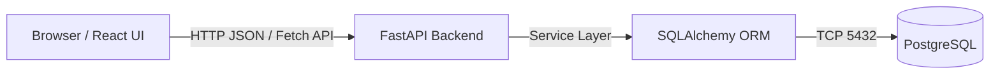

# High-Level Design (HLD) — Expense Tracker

## 1. Project Objective
Provide a clean, single-user full-stack web application for recording, managing, filtering, and analyzing personal expenses with reliable persistence and strict server-side validation.

## 2. Scope
### In Scope
- Create, read, update, and delete (CRUD) personal expenses
- Filter expenses by category and date range
- Dashboard summary: total spending, expense count, and category-wise breakdown
- Server-side and client-side input validation
- Loading, empty, error, and success UI states
- Dockerized local development environment (Frontend, Backend, PostgreSQL)

### Out of Scope
- Authentication, user accounts, JWT, or multi-tenancy
- Budgets, recurring expenses, payments, or email notifications
- Message brokers, caching layers, microservices, or cloud deployment

## 3. Technology Stack
- **Frontend:** React, JavaScript, Vite, CSS, Fetch API
- **Backend:** Python 3, FastAPI, Uvicorn, Pydantic
- **Database & ORM:** PostgreSQL 16, SQLAlchemy 2.0
- **Testing:** pytest, FastAPI TestClient, Postman
- **Containerization:** Docker, Docker Compose

## 4. Architecture
The system follows a classic three-tier architecture:

## 5. Request Flow
1. The user interacts with the React UI (e.g., submits the expense form or changes a filter).
2. `frontend/src/services/api.js` sends an HTTP request to `VITE_API_BASE_URL` (`/api/v1/expenses...`).
3. FastAPI routes in `backend/app/api/expenses.py` validate path/query/body inputs using Pydantic schemas.
4. Business logic in `backend/app/services/expense.py` executes database operations via SQLAlchemy ORM.
5. PostgreSQL persists or queries the `expenses` table and returns rows to SQLAlchemy.
6. FastAPI serializes the result through Pydantic response schemas and returns JSON to the React frontend.
7. React updates state and refreshes the dashboard summary and expense table.

## 6. Component Responsibilities
- **Frontend (`frontend/`):** Renders the dashboard, form, filters, and expense list; manages UI state and delegates all HTTP communication to `src/services/api.js`.
- **Backend API (`backend/app/api/`):** Defines HTTP endpoints, status codes, and query/path parameter validation.
- **Backend Services (`backend/app/services/`):** Encapsulates CRUD queries and summary aggregations.
- **Backend Models & Schemas (`backend/app/models/`, `backend/app/schemas/`):** Defines PostgreSQL table structure and Pydantic validation/serialization rules.
- **PostgreSQL (`db` service):** Stores expense records reliably using `Numeric(10, 2)` for currency.

## 7. Database Overview
A single `expenses` table stores all records with exact decimal amounts (`Numeric(10, 2)`), predefined category strings, optional descriptions up to 250 characters, expense dates, and automatic `created_at`/`updated_at` timestamps.

## 8. Local Docker Architecture
Docker Compose runs three containers on a shared bridge network:
- `frontend` (port `5173`) — Vite dev server
- `backend` (port `8000`) — Uvicorn serving FastAPI
- `db` (port `5432`) — PostgreSQL 16 with a named persistent volume (`postgres_data`)

## 9. Success Criteria
- All 7 API endpoints behave according to the API contract and OpenAPI docs.
- `pytest` suite passes against an isolated test database.
- Frontend builds cleanly and performs full CRUD + filtering + summary updates against the backend.
- `docker compose up --build` starts all three services cleanly.

